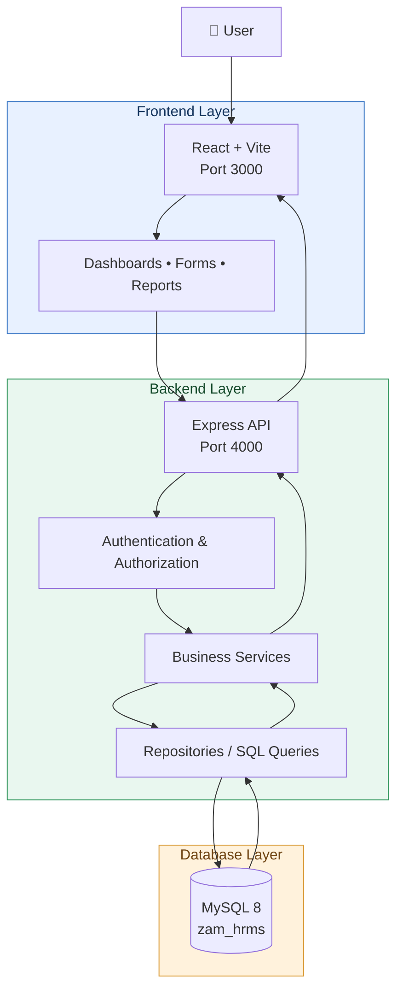
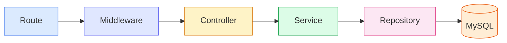
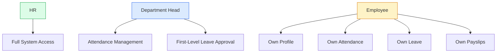
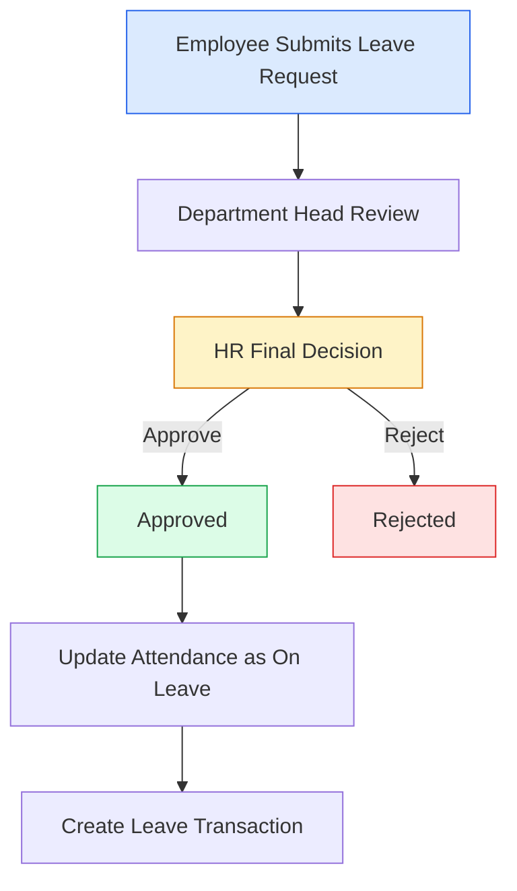

# 🏢 ZAM HRMS
### Human Resource Management System

<p align="center">
  <strong>Employee Management | Attendance | Leave | Payroll</strong>
</p>

<p align="center">
  React + Vite • Node.js • Express • MySQL
</p>

---

## 📌 Project Overview

ZAM HRMS is a full-stack Human Resource Management System
developed to centralize and automate employee management,
attendance tracking, leave management, and payroll processing.

The system provides role-based access for HR, Department Heads,
and Employees to ensure secure and controlled access to
organizational information.

## ✨ Key Features

| Module | Features |
|---|---|
| 👥 Employee Management | Employee profiles and employment records |
| 🕒 Attendance | Daily attendance, check-in/out, timesheets and corrections |
| 🏖️ Leave Management | Leave applications, approvals and leave balances |
| 💰 Payroll | Salary calculations, deductions, overtime and payslips |
| 📊 Reports | Employee, attendance and payroll reports |
| 🔐 User Management | Authentication and role-based permissions |
| 📝 Audit Logging | Records changes and user activities |

---

## 🛠️ Technology Stack

| Layer | Technology |
|---|---|
| Frontend | React + Vite |
| Backend | Node.js + Express.js |
| Database | MySQL 8 |
| Authentication | Bearer Token |
| Password Hashing | bcrypt |
| Database Operations | MySQL Pool & Transactions |
| Shared Logic | JavaScript |
| Runtime | Node.js 20+ |

---

## 📁 Project Structure

```text
zam-shipping---fleet-hrms/
│
├── frontend/                  # React + Vite application
│
├── backend/                   # Express API
│   ├── scripts/
│   │   ├── db-setup.js
│   │   ├── db-seed.js
│   │   └── sql-runner.js
│   │
│   ├── src/
│   │   ├── config/
│   │   ├── routes/
│   │   ├── controllers/
│   │   ├── middleware/
│   │   ├── services/
│   │   ├── repositories/
│   │   ├── jobs/
│   │   ├── utils/
│   │   ├── app.js
│   │   └── server.js
│   │
│   └── .env
│
├── database/
│   ├── zam_hrms.sql
│   ├── 02_extensions.sql
│   └── 03_seed.sql
│
├── shared/
│   ├── attendance/
│   ├── leave/
│   ├── payroll/
│   ├── dates.js
│   └── permissions.js
│
├── package.json
└── README.md
```

---

## 🏗️ System Architecture



### Request Processing Flow

Every request follows this sequence:



Each action executes inside a database transaction,
checks permissions, and records changes in `audit_log`.

---

## 🔐 User Roles & Permissions

The application supports three primary roles.



| Role | Access |
|---|---|
| HR | Complete system access |
| Department Head | Attendance management and first-level leave approval |
| Employee | Own profile, attendance, leave and payslips |

Permissions are defined in `shared/permissions.js`
and enforced by the backend.

---

## 🔌 API Endpoints

| Method | Endpoint | Purpose |
|---|---|---|
| GET | `/api/health` | Database connectivity |
| POST | `/api/auth/login` | User login |
| GET | `/api/auth/me` | Current authenticated user |
| GET | `/api/state` | Role-based application data |
| POST | `/api/actions/:name` | Execute application actions |

### Login Request

```json
{
  "username": "657",
  "password": "your_password"
}
```

The server verifies credentials and retrieves the user's
role from the database.

---

## ⚙️ Installation & Setup

### Prerequisites

- Node.js 20+
- MySQL 8
- MySQL Server service (`MySQL80`)
- Git

### 1. Clone the Repository

```bash
git clone YOUR_REPOSITORY_URL
cd zam-shipping---fleet-hrms
```

### 2. Configure Database Credentials

Open `backend/.env` and configure:

```env
DB_HOST=localhost
DB_PORT=3306
DB_USER=root
DB_PASSWORD=your_mysql_password
DB_NAME=zam_hrms

AUTH_SECRET=your_secure_secret
PORT=4000
```

Use your actual MySQL password.
Never upload `.env` to GitHub.

### 3. Install Dependencies

Run from the project root:

```bash
npm install
```

### 4. Create Database

```bash
npm run db:setup
```

This executes:

- `database/zam_hrms.sql`
- `database/02_extensions.sql`

### 5. Optional Demo Data

```bash
npm run db:seed
```

Demo data includes employees:

- 657
- 50401
- 50403
- 50404
- 50405

After seeding, run:

```bash
npm run db:setup
```

This ensures the users defined in the main SQL file are inserted.

**Important:** Skip demo seeding if your database already contains real employee records.

### 6. Start the Application

```bash
npm run dev
```

Open:

```text
http://localhost:3000
```

### Run Frontend and Backend Separately

Terminal 1:

```bash
npm run dev:backend
```

Terminal 2:

```bash
npm run dev:frontend
```

---

## 🕒 Attendance Management

HR and Department Heads can:

- Mark Present (P)
- Mark Absent (A)
- Mark Late (L)
- Mark Half Day (HD)
- Mark all eligible employees Present
- Enter check-in and check-out times
- Review and correct attendance records

### Attendance Rules

Example: Non-Manager Schedule

| Condition | Attendance Status |
|---|---|
| Check-in up to 09:00 | Present |
| 09:01 – 10:30 | Late |
| After 10:30 | Half Day |
| No check-in by 18:00 | Absent |

The automatic absence job runs at application startup
and every 10 minutes.

It skips:

- Off days
- Holidays
- Approved leave
- Dates before employee joining

The `AUTO_ABSENT_DAYS` environment variable controls
how far back the job checks for missing attendance.

---

## 🏖️ Leave Management

### Leave Approval Workflow



1. Employee submits a leave request.
2. Working days are calculated automatically.
3. Department Head provides the first-level decision.
4. HR makes the final decision.
5. Approved leave updates attendance records.
6. A leave transaction is recorded.

HR can make the final decision even while the
Department Head's decision is pending.

Off days and holidays are excluded from working-day calculations.

---

## 💰 Payroll Management

### Pay Period

The company follows a monthly payroll period from
the **26th of one month to the 25th of the next month**.

Example:

```text
November 2026
26 October 2026 → 25 November 2026
```

Payroll, timesheets, reports and dashboards use this period.

The pay-period start day can be configured in:

```javascript
shared/dates.js

export const PAY_PERIOD_START_DAY = 26;
```

### Salary Structure

Monthly gross salary is divided into:

| Component | Percentage |
|---|---:|
| Basic Salary | 60% |
| House Rent | 30% |
| Utility Allowance | 10% |
| **Total** | **100%** |

### Payroll Calculations

- Overtime: 1.5x on working days.
- Overtime: 2x on off days.
- Hourly rate: Gross salary ÷ 176.
- Loss of Pay: Absences, unpaid leave, half days,
  every three late arrivals (half-day deduction),
  and days before joining.
- Income tax: FBR salaried slabs (Finance Act 2025).
- Employee EOBI: Rs 370.
- Employer EOBI: Rs 1,850.

Payroll rules can be managed under:

**Payroll → Pay Rules & Tax**

### Payroll Finalization

Finalizing a payroll period stores the generated
payslips in `payroll_run` and publishes them to employees.

---

## 📊 Background Jobs

The backend runs scheduled background tasks.

| Job | Frequency | Purpose |
|---|---|---|
| Auto-Absent | Every 10 minutes | Records missing attendance for eligible working days |

Configuration:

```env
AUTO_ABSENT_DAYS=31
```

Set `0` to disable the automatic absence job.

---

## 🗄️ Database Files

| File | Description |
|---|---|
| `database/zam_hrms.sql` | Main database schema |
| `database/02_extensions.sql` | Additional application tables and columns |
| `database/03_seed.sql` | Optional demo records |

The extension scripts include reporting manager,
personal and emergency details, bank details,
GPS check-in, breaks, job history, payroll runs,
settings and policy acknowledgements.

---

## 🚀 Production Build

Build the frontend:

```bash
npm run build
```

Start the production server:

```bash
npm start
```

The Express server serves the API and the compiled
`frontend/dist` application on port `4000`.

**Deployment note:** The production backend requires a
reachable MySQL database and correctly configured environment
variables. Vercel deployment of the frontend alone does not
host a persistent Express server or MySQL database.

---

## 🔒 Security

- Passwords are stored using bcrypt hashes.
- Authentication uses Bearer Tokens.
- Role-based authorization is enforced by the backend.
- Database modifications use transactions.
- Application changes are recorded in `audit_log`.
- Database credentials and authentication secrets
  must remain in environment variables.
- `.env` files must never be committed to Git.

---

## 👨‍💻 Development Notes

### Run Development Server

```bash
npm run dev
```

### Install Packages

```bash
npm install
```

### Initialize Database

```bash
npm run db:setup
```

### Seed Demo Data

```bash
npm run db:seed
```

### Build Frontend

```bash
npm run build
```

---

## 📌 Important Configuration Files

| File | Responsibility |
|---|---|
| `backend/.env` | Database credentials, API port and authentication secret |
| `shared/dates.js` | Date and payroll-period calculations |
| `shared/permissions.js` | Role-based permissions |
| `frontend/src/config/offices.js` | GPS office coordinates |
| `backend/src/config/database.js` | MySQL connection pool and transactions |
| `backend/src/app.js` | Express application configuration |
| `backend/src/server.js` | HTTP server and background jobs |

---

## 📄 License

This project is developed for ZAM HRMS.
